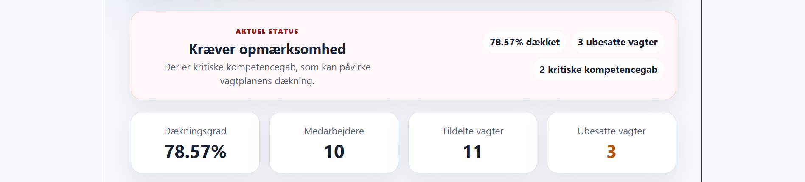
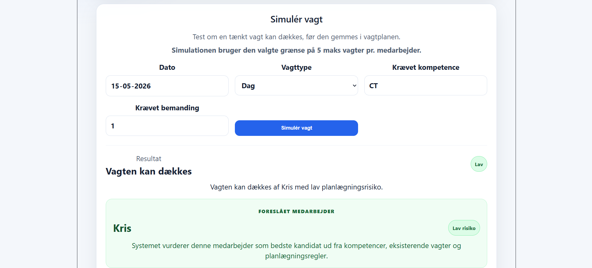
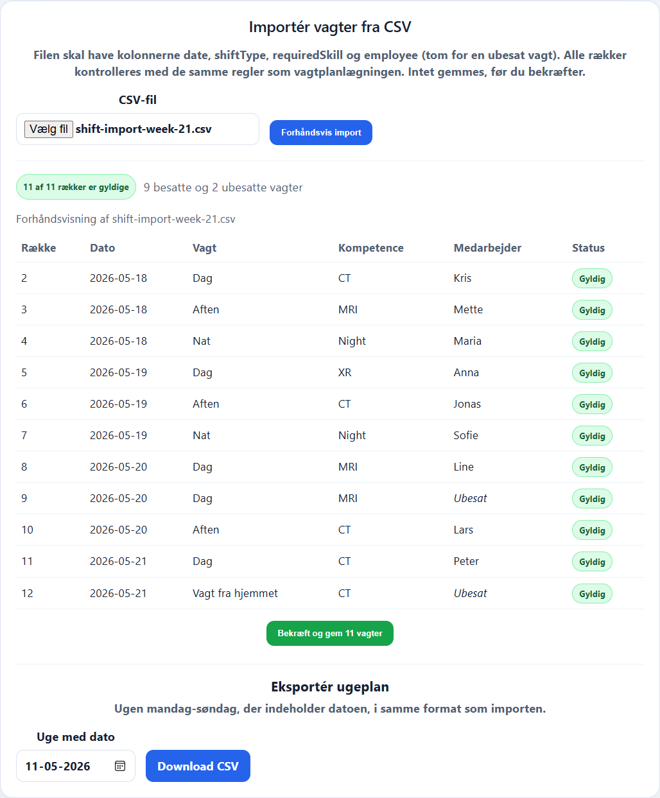

# Recruiter quick review — ShiftPlanner API

**What it demonstrates:** C# / ASP.NET Core 10, Clean Architecture, EF Core + SQLite, React / TypeScript, explainable business rules, testable scheduling decisions and API integration testing.

**Cost:** Free local demo. No paid hosting, Microsoft account, Docker or separate database installation is required for the standard .NET + React setup.

## First look without installing anything

| Scheduling overview | Simulation | CSV import preview |
| --- | --- | --- |
|  |  |  |

- [Business features and technical overview](../README.md#portfolio-highlights)
- [Backend architecture](../README.md#architecture)
- [Developer walkthrough](PROJECT_WALKTHROUGH.md)
- [Public demo scope](../README.md#public-portfolio-scope)

## Try it on your machine

Requirements: .NET 10 SDK, Node.js 24 and npm. The API uses SQLite; a separate database server is not required.

```bash
git clone https://github.com/kris7011/shift-planner-api.git
cd shift-planner-api
```

**Terminal 1 — API:**

```bash
dotnet run --project src/ShiftPlanner.Api --launch-profile http
```

The API's configured local address is **http://localhost:5026**.

**Terminal 2 — web dashboard (from the repository root):**

```bash
npm --prefix frontend ci
npm --prefix frontend run dev
```

Open **http://localhost:5173**. The frontend's default API address is `http://localhost:5026` (see `frontend/.env.example`).

**Seed a disposable demo schedule** after the API is running. This endpoint replaces current employees and shifts; do not run it against data you want to preserve.

PowerShell:

```powershell
Invoke-RestMethod -Method Post -Uri http://localhost:5026/api/demo/reset
```

Bash or another shell where `curl` is the real curl executable:

```bash
curl -X POST http://localhost:5026/api/demo/reset
```

The demo provides 10 example employees and 14 shifts, including intentional uncovered shifts and skill gaps. Open the dashboard to explore its views. The backend also exposes **http://localhost:5026/swagger** in Development.

## Five-minute code-review tour

1. **Overview:** inspect coverage, workload indicators, unassigned shifts and skill gaps.
2. **Weekly schedule and employee views:** check who has been assigned, how load is calculated and why someone is considered suitable or unsuitable.
3. **What-if simulation:** explore candidates and explanations without committing the simulated assignment.
4. **CSV import:** preview valid and invalid input before an explicit confirmation. Review duplicate protection and the guarantee that a preview does not write shifts.
5. **Tests and architecture:** run `dotnet test`; for the React tests run `npm --prefix frontend test`. Review the separation between domain rules, application logic, persistence and API.

## What the demo does not prove

This is a simplified, public portfolio implementation. Its data and scheduling rules are illustrative, not a validated model of any actual department or labour agreement. It has no production authentication or operational service commitment. See [public portfolio scope](../README.md#public-portfolio-scope).

**For an interview:** discuss why the same validation must apply to automatic assignment, CSV import confirmation and manual operations; how failed constraints are explained; and why a simulation must not change saved data.
